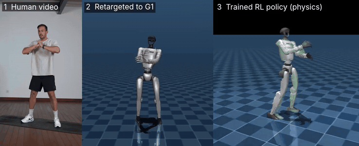
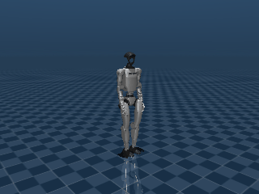

# video2g1

### From a phone video to a humanoid robot skill



*(1) A video of a person doing a squat. (2) The motion retargeted to the 29-joint Unitree G1.
(3) A reinforcement-learning policy performing it with full physics: the robot balances on its own
motors. The green ghost is the reference motion. Trained in mjlab on a 6 GB laptop GPU (RTX 4050).*

**What this is.** Robots learn from data, and robot data is scarce. Videos of people moving are
everywhere. video2g1 takes an ordinary video of a person, turns it into motion for the Unitree G1, and
trains a policy so the robot performs the movement itself, with motors and physics rather than as a
puppet. The long-term goal is a library of skills learned from video that you can call in plain
language ("do a squat").

## The full plan

video → 3D body keypoints → G1 joint angles → motion-tracking policy → skills called by language

✅ done · ⬜ planned. Details for each step are in [docs/ROADMAP.md](docs/ROADMAP.md).

### Phase 1: Video → robot motion
- ✅ Pose estimation from a single video on a laptop CPU (MediaPipe)
- ✅ Retargeting to the 29-joint G1: joint limits, flat feet, planted-foot IK, stance-foot anchoring
- ✅ Modes for in-place motions (`--in-place`) and waist-up videos (`--upper-body`)
- ✅ Quality checks per clip: foot sliding, jitter, camera cuts; side-by-side video output
- ⬜ High-quality pose backend (GVHMR + GMR) for walking and side views
- ⬜ Foot and wrist orientation from heel, toe and hand landmarks
- ⬜ Live webcam mode: move in front of your laptop, the G1 copies you

### Phase 2: Robot motion → trained policy
- ✅ Single-clip tracking policy in mjlab (squat), trained on a 6 GB laptop GPU
- ⬜ One policy for several motions (squat + wave), then 20+ clips (own videos + LAFAN1)
- ⬜ Sim-to-sim check: run the MuJoCo-trained policy in Isaac Lab
- ⬜ Deployment on a real Unitree G1

### Phase 3: Language → skills
- ⬜ Skill library: each trained motion gets a name and a description
- ⬜ A language model turns "wave, then squat" into a skill sequence
- ⬜ Smooth transitions between skills
- ⬜ A vision-language model looks at the scene and picks the next skill
- ⬜ Stretch: a text-to-video model generates the human video, and the pipeline learns a brand-new skill

### Research question
How much does pose-estimation quality matter? Policies trained from cheap laptop pose (MediaPipe)
are compared with policies trained from a high-quality model (GVHMR) on the same clips, measuring
tracking error and success rate.

## Quick start

```bash
pip install -e .            # core: mujoco + numpy
./scripts/get_g1.sh         # fetches the G1 model from MuJoCo Menagerie
G1=third_party/mujoco_menagerie/unitree_g1/scene.xml

# 1) No video needed: synthetic human -> G1 (wave -> squat -> walk, shown below)
python -m video2g1.cli demo --model $G1 --out outputs/demo

# 2) Your own video (person fully visible, one person, static camera works best)
pip install -e ".[video]"
python -m video2g1.cli run my_video.mp4 --model $G1 --out outputs/my_clip --view
```



Useful flags for `run`:

| Flag | Use it for |
|---|---|
| `--in-place` | Motions where the feet stay put (squat, wave, arm moves): feet are pinned to the floor, heading is locked |
| `--upper-body` | Waist-up videos: legs stay standing, only arms and torso are copied |
| `--smooth 0.1` | Shaky clips (default 0.05 s of keypoint smoothing) |
| `--start 5.2 --end 10.1` | Keep one part of a clip; the tool warns if it finds camera cuts |
| `--view` | Open the interactive MuJoCo viewer |

On a headless machine add `MUJOCO_GL=egl`. Each run writes:

- `*.csv`: 36 columns, no header: root `x y z`, root quaternion `qx qy qz qw`, 29 joint angles.
  This is Unitree's convention, the format the LAFAN1 retargeted dataset, BeyondMimic and mjlab use.
- `*.npz`: MuJoCo `qpos` (quaternion `wxyz`), fps and joint names.
- `*.mp4` / `*.gif`: a render of the G1 performing the motion.
- `*_side_by_side.mp4`: the source video next to the G1 (video input only).

Each run also prints quality numbers: foot slide while planted, pelvis path, heading range,
joint jitter and peak joint speed (see `video2g1/quality.py`).

## Train a tracking policy (phase 2)

Uses [mjlab](https://github.com/mujocolab/mjlab) (needs an NVIDIA GPU; a 6 GB laptop GPU works with 1024 environments).

```bash
cd mjlab
MUJOCO_GL=egl uv run -m mjlab.scripts.csv_to_npz --input-file /path/to/outputs/squat.csv \
    --output-name squat --input-fps 25 --output-fps 50 --render True   # use your clip's fps
cp /tmp/motion.npz motions/squat.npz
uv run train Mjlab-Tracking-Flat-Unitree-G1 --env.commands.motion.motion-file motions/squat.npz \
    --env.scene.num-envs 1024 --agent.max-iterations 3000
uv run play Mjlab-Tracking-Flat-Unitree-G1 --checkpoint-file latest --motion-file motions/squat.npz \
    --video True --video-length 300 --video-height 720 --video-width 1280
```

The converter also uploads the motion to a Weights & Biases registry, so a W&B login is needed.

**Several motions, one policy.** mjlab trains on one motion file, so stitch clips first. Each clip is
resampled to a common frame rate, placed where the previous one ends and joined by a 1 s blend.
Waist-up clips (`--upper-body`) keep the previous clip's stance, so the feet never slide at a join:

```bash
python -m video2g1.cli concat outputs/squat.npz outputs/wave.npz --model $G1 --out outputs/squat_wave
# then convert outputs/squat_wave.csv with --input-fps 30 and train as above
```

## How the retargeting works

1. **Root orientation** comes from the human hips and torso.
2. **Directions from the human, lengths from the robot.** Each limb segment keeps the human's direction
   but uses the G1's own segment length, so every target is reachable.
3. **Damped least-squares IK** over the 29 joints, warm-started from the previous frame, with joint
   limits, a smoothness term and a term that keeps the soles parallel to the floor.
4. **Stance-foot anchoring.** MediaPipe gives a hip-centred pose with no global position. The lower
   foot is assumed to be planted, which recovers root height and forward travel and prevents that
   foot from sliding. With `--in-place`, both feet are pinned inside the IK and the pelvis moves instead.

## Known limitations (v0.1)

- The retargeter itself is kinematic: balance and torque limits are handled by the tracking policy (phase 2).
- One camera gives poor depth: side views and walking toward the camera retarget badly. A
  world-grounded pose model (GVHMR) is planned for these cases.
- Results are in simulation only so far, with one trained clip (squat).
- No jumps or flight phases (one foot is always assumed to be on the ground).
- Wrists and feet have no orientation tracking yet.
- No self-collision avoidance.

## Related work

This builds on ideas from, and is meant to plug into, existing open tools:
[GMR](https://github.com/YanjieZe/GMR) (general motion retargeting, also supports video via GVHMR),
[GVHMR](https://github.com/zju3dv/GVHMR) (world-grounded human motion from video),
[BeyondMimic](https://github.com/HybridRobotics/whole_body_tracking) and
[mjlab](https://github.com/mujocolab/mjlab) (motion-tracking RL).
GMR + GVHMR give higher-quality retargeting but need a GPU and the SMPL-X body model.
video2g1 aims to be the version anyone can run on a laptop, and to carry the pipeline through to
a trained policy and a language interface.

## License

MIT. The G1 model comes from MuJoCo Menagerie under its own license.
